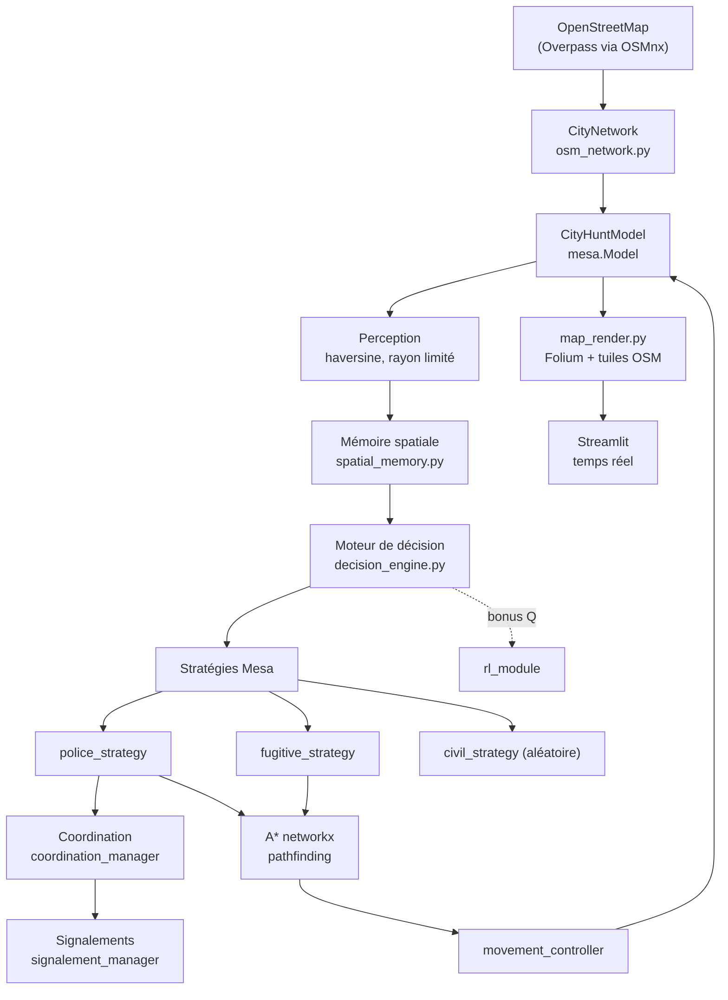
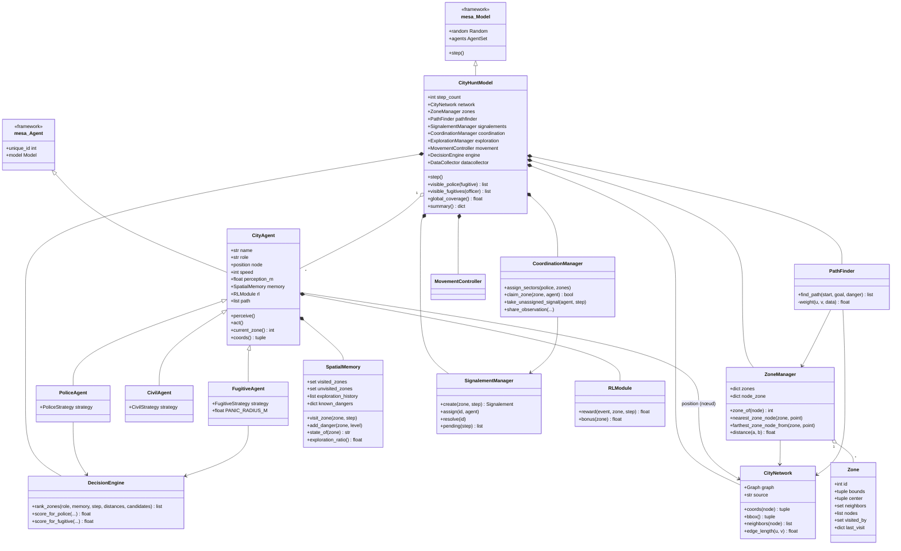
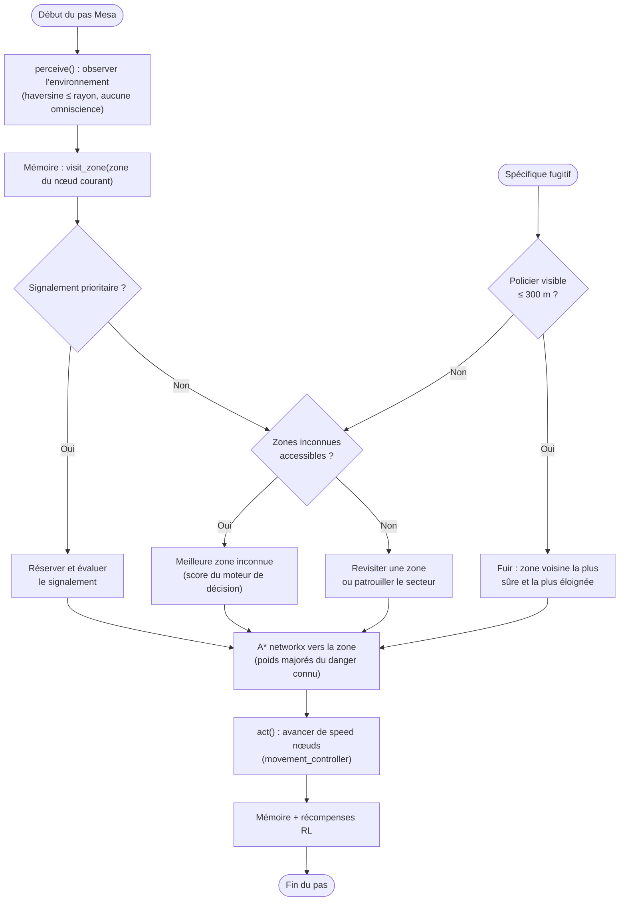
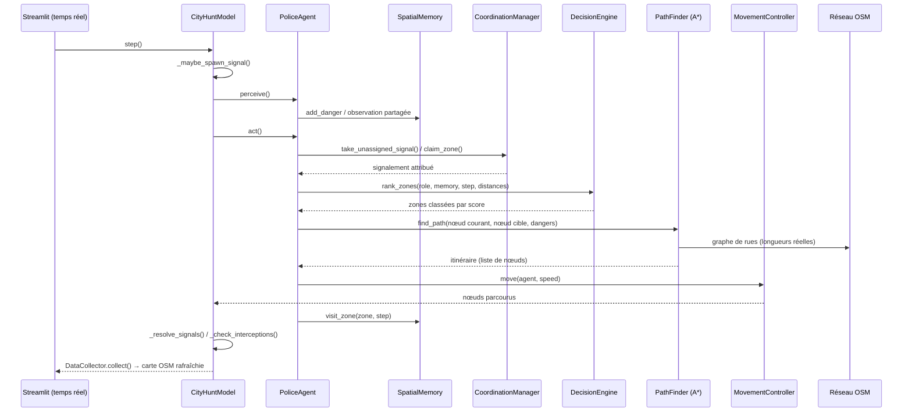
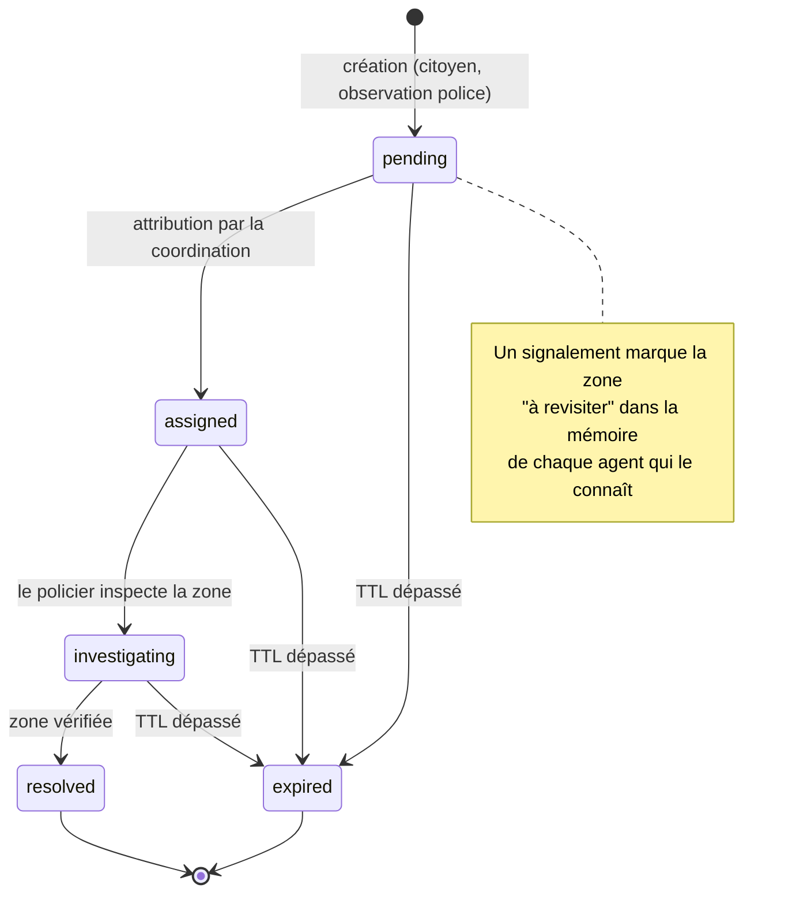
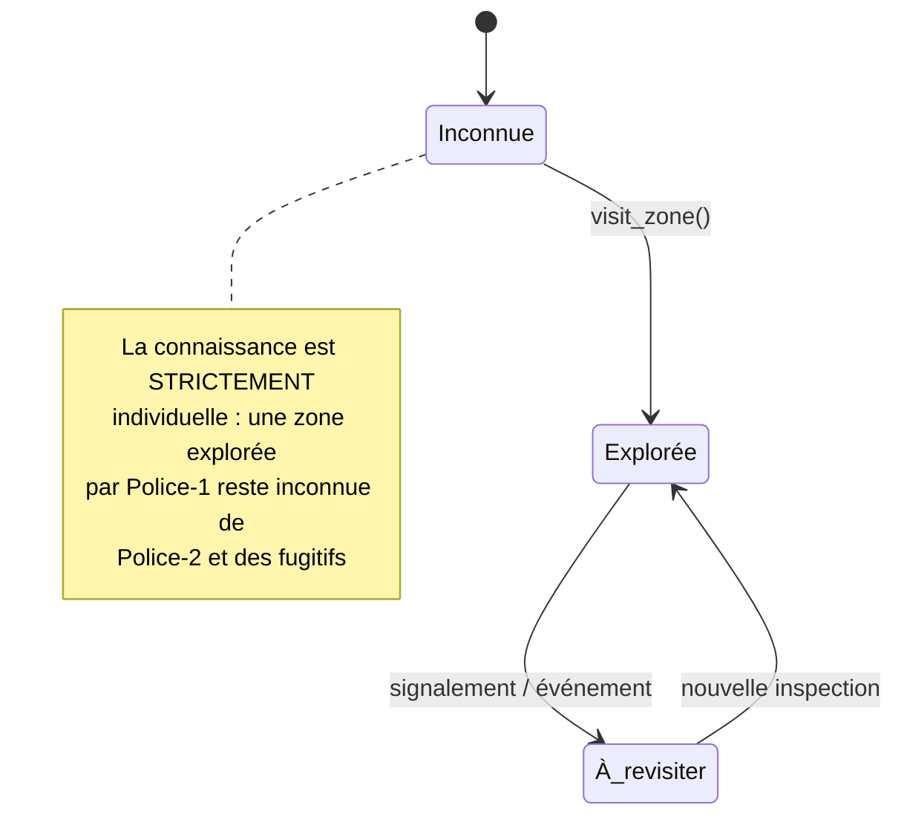
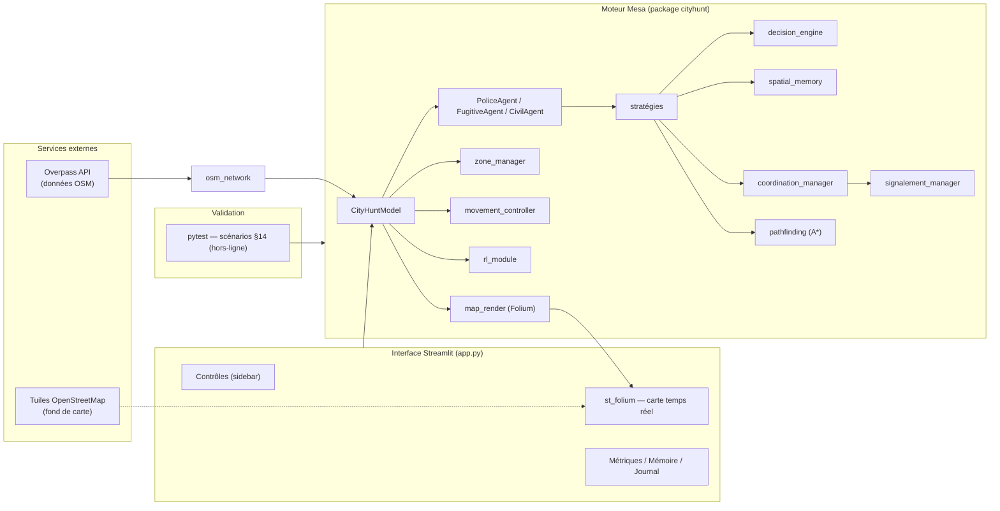
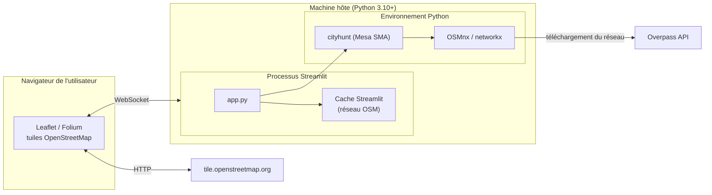

# CityHunt v3.0 — Documentation fonctionnelle et technique

**Type :** Système multi-agents (SMA) · **Moteur :** Mesa · **Carte :** OpenStreetMap (OSMnx + Folium) · **UI :** Streamlit · **Version :** 3.0

Ce document décrit l'implémentation de la spécification CityHunt sur le réseau
de rues réel d'une ville : mémoire spatiale individuelle, exploration
méthodique, signalements, coordination policière, pathfinding A* sur le graphe
OSM, apprentissage par renforcement et visualisation temps réel.

---

## 1. Architecture générale

| Module | Responsabilité | Spéc. |
|---|---|---|
| `osm_network.py` | Réseau de rues réel (OSMnx/Overpass) + repli hors-ligne synthétique | carte |
| `zone_manager.py` | Partition géographique de la bbox OSM en zones | §4 |
| `spatial_memory.py` | Mémoire spatiale individuelle (`SpatialMemory`) | §5 |
| `exploration_manager.py` | Couverture, historique, fin d'exploration | §7 |
| `decision_engine.py` | Scores de zones et sélection des destinations | §6 |
| `police_strategy.py` | Stratégie policière | §3.1 |
| `fugitive_strategy.py` | Stratégie de fuite | §3.2 |
| `civil_strategy.py` | Déplacement aléatoire | §3.3 |
| `coordination_manager.py` | Partage d'informations et réservations | §8 |
| `signalement_manager.py` | Cycle de vie des signalements | §7.3 |
| `pathfinding.py` | Itinéraires A* sur le graphe de rues | §9 |
| `movement_controller.py` | Exécution des déplacements (nœud par nœud) | §9 |
| `rl_module.py` | Récompenses et Q-values | §12 |
| `agents.py` | Agents Mesa (`PoliceAgent`, `FugitiveAgent`, `CivilAgent`) | §10 |
| `model.py` | `CityHuntModel` (hérite de `mesa.Model`) | §10 |
| `map_render.py` | Rendu Folium sur tuiles OpenStreetMap | temps réel |
| `app.py` | Interface Streamlit temps réel | UI |



---

## 2. Diagramme de classes UML (Mesa)



---

## 3. Diagramme d'objets (OD) — instantané de simulation

État au pas 42 sur la carte de Toulouse : deux policiers, un fugitif, un civil.

```mermaid
objectDiagram
    object "CityHuntModel : CityHuntModel" as model
    model : step_count = 42
    model : source = "osm"

    object "Police-1 : PoliceAgent" as p1
    p1 : position = node 12345678
    p1 : speed = 2
    p1 : perception_m = 250.0

    object "m1 : SpatialMemory" as m1
    m1 : visited_zones = {0, 1, 5, 6}
    m1 : unvisited_zones = {2, 3, 4, ...}
    m1 : current_zone = 6

    object "Fugitif-1 : FugitiveAgent" as f1
    f1 : position = node 98765432

    object "mF : SpatialMemory" as mf
    mf : known_dangers = {6: 0.4}
    mf : unvisited_zones = {8, 9, 13, ...}

    object "SIG-0007 : Signalement" as s7
    s7 : zone_id = 6
    s7 : status = "investigating"
    s7 : priority = 2

    object "Civil-1 : CivilAgent" as c1
    c1 : position = node 55512344

    object "Z6 : Zone" as z6
    z6 : center = (43.6061, 1.4442)
    z6 : visited_by = {"Police-1"}

    model o-- p1
    model o-- f1
    model o-- c1
    p1 *-- m1
    f1 *-- mf
    s7 --> p1 : assigned_to
    z6 --> model : zones[6]
```

---

## 4. Cycle de décision (diagramme d'activité)



---

## 5. Diagramme de séquence — un pas de simulation Mesa



---

## 6. Diagrammes d'états

### 6.1 Cycle de vie d'un signalement



### 6.2 Connaissance d'une zone par un agent



---

## 7. Diagramme de composants



---

## 8. Diagramme de déploiement



- **Un seul processus** Streamlit héberge le modèle Mesa ; l'état vit dans `st.session_state`.
- Le **réseau de rues** est téléchargé une seule fois par ville (cache `st.cache_resource`).
- Les **tuiles OpenStreetMap** sont chargées directement par le navigateur (Leaflet).
- Si Overpass est injoignable, `osm_network` bascule sur la grille synthétique : la simulation reste opérationnelle et le fond de carte reste OSM.

---

## 9. Moteur de décision

### 9.1 Scores (§6 de la spécification)

**Police** — `Score(z) = w1·S(z) + w2·P(z) + w3·U(z) − w4·D(z)` (distances en km)

| Terme | Implémentation (`decision_engine.py`) |
|---|---|
| `S(z)` pertinence du signalement | priorité × confiance × fraîcheur des signalements connus |
| `P(z)` probabilité de présence | observations uniquement (signalements, ancienneté de la dernière visite) |
| `U(z)` intérêt d'exploration | 1.0 inconnue, 0.8 à revisiter, sinon décroît avec l'ancienneté |
| `D(z)` coût du déplacement | distance haversine entre centres de zones (km) |

**Fugitif** — `Score(z) = w1·E(z) + w2·S(z) − w3·R(z) − w4·C(z)`

| Terme | Implémentation |
|---|---|
| `E(z)` intérêt d'exploration | identique à `U(z)` |
| `S(z)` sécurité estimée | `1 − danger connu de la zone` |
| `R(z)` risque de rencontre | danger mémorisé (zones où un policier a été vu) |
| `C(z)` coût du déplacement | distance haversine (km) |

Les poids sont ajustables dans la barre latérale Streamlit.

### 9.2 Priorités du cycle (§11)

1. **Police** : signalement attribué → poursuite d'un fugitif **visible** → zones inconnues → revisite / patrouille du secteur assigné.
2. **Fugitif** : fuite si policier ≤ 300 m → zones inconnues sûres → zones connues sûres.
3. **Civil** : nœud voisin aléatoire à chaque pas.

---

## 10. Carte OpenStreetMap et temps réel

- **Chargement** : `osmnx.graph_from_place(place)` (ou `graph_from_point`) télécharge
  le réseau routier réel ; le graphe est simplifié en `nx.Graph` pondéré par la
  longueur réelle des rues (mètres).
- **Rendu** : `map_render.build_map()` produit une carte Folium (tuiles
  OpenStreetMap) avec : rectangles de zones colorés selon la mémoire de
  l'agent sélectionné, marqueurs des agents (🛡️ police, ⚠️ fugitif, 👤 civil),
  PolyLine de l'itinéraire A* courant.
- **Temps réel** : le mode « ⏱️ Temps réel » exécute un pas Mesa puis
  `st.rerun()` — la carte, les marqueurs, les zones et les métriques sont
  rafraîchis à chaque pas selon la cadence choisie.
- **Repli** : sans accès Overpass, une grille Manhattan synthétique centrée sur
  la ville est générée (`load_synthetic_network`) ; l'indicateur « Source du
  réseau » affiche le mode actif.

## 11. Pathfinding A* (§9)

`PathFinder.find_path(start, goal, danger)` — A* networkx sur le graphe de rues :

- `f(n) = g(n) + h(n)` ; poids des arcs = `longueur_rue × (1 + 10 × danger_connu(zone))` ;
- heuristique haversine en mètres (admissible) ;
- recalcul automatique si l'itinéraire devient invalide (F13).

## 12. Apprentissage par renforcement (§12, Phase 7)

`RLModule` : Q-values par zone, `q ← q + α·(r − q)`, récompenses de la spécification
(+5 nouvelle zone, +15 signalement vérifié, +100 interception, −5 déplacement
inutile, +100 évasion, −20 détection). Bonus `0.05 × q[zone]` ajouté au score.
Aucune récompense ne révèle la position d'un adversaire (F12).

## 13. Traçabilité des exigences F01–F15

| ID | Exigence | Implémentation | Test |
|---|---|---|---|
| F01 | Police non aléatoire | `PoliceStrategy.decide` | `test_1`, `test_f01_f02` |
| F02 | Fugitifs non aléatoires | `FugitiveStrategy.decide` | `test_4`, `test_f01_f02` |
| F03 | Civils aléatoires | `CivilStrategy.decide` | `test_f03` |
| F04 | Mémoire individuelle | `SpatialMemory` par agent | tous |
| F05 | Persistance des zones visitées | mémoire jamais réinitialisée | `test_f05_f14` |
| F06 | Zones inconnues prioritaires | candidats + score `U` | `test_1` |
| F07 | Revisite sur événement | `mark_to_revisit` + signalements | `test_2` |
| F08 | Partage d'informations | `CoordinationManager` | `test_3` |
| F09 | Éviter les doublons | `claim_zone`, secteurs | `test_3` |
| F10 | Adaptation aux dangers | `known_dangers`, `_flee` | `test_4` |
| F11 | Obstacles / réseau réel | A* sur le graphe de rues | `test_f11` |
| F12 | Pas d'omniscience | perception haversine à rayon limité | `test_5` |
| F13 | Recalcul des destinations | `route_is_valid` + redécision | `test_f11` |
| F14 | Historique conservé | `exploration_history` | `test_f05_f14` |
| F15 | Amélioration par apprentissage | `RLModule` | `test_interception_possible` |

## 14. Utilisation de l'interface Streamlit

1. **Barre latérale** : ville OpenStreetMap (nom OSM), découpage en zones, rayon,
   effectifs, vitesses, perception (mètres), poids des scores, RL, graine.
2. **▶ 1 pas / ▶▶ 10 pas / ▶▶▶ 50 pas** : avancer la simulation Mesa.
3. **⏱️ Temps réel** : exécution continue avec rafraîchissement de la carte OSM.
4. Onglet **Carte OSM** : sélectionner un agent pour voir **sa** mémoire
   (⬜ inconnue, 🟦 explorée, 🟧 à revisiter) et son itinéraire A* en bleu.
5. Onglets **Métriques**, **Mémoire**, **Journal** : couverture, signalements,
   historique d'exploration, observations partagées, interceptions.
