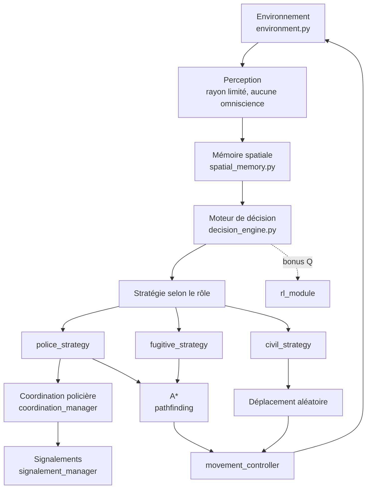
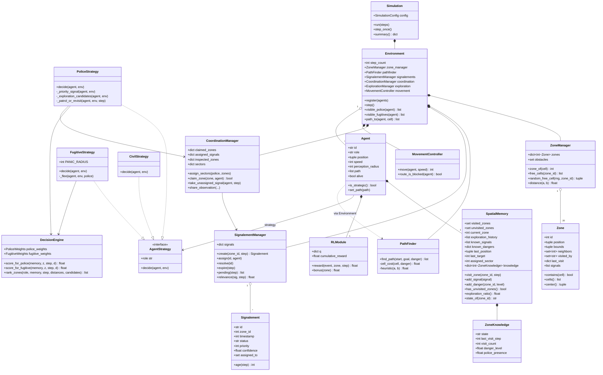
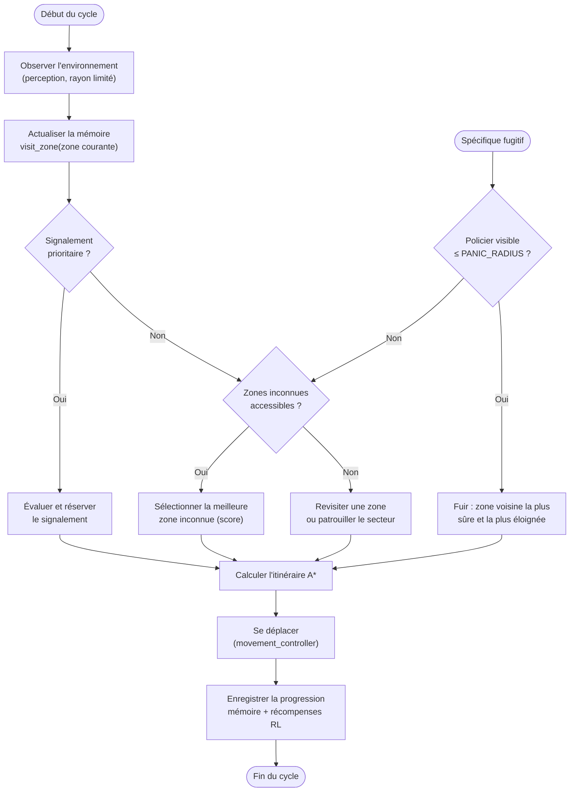
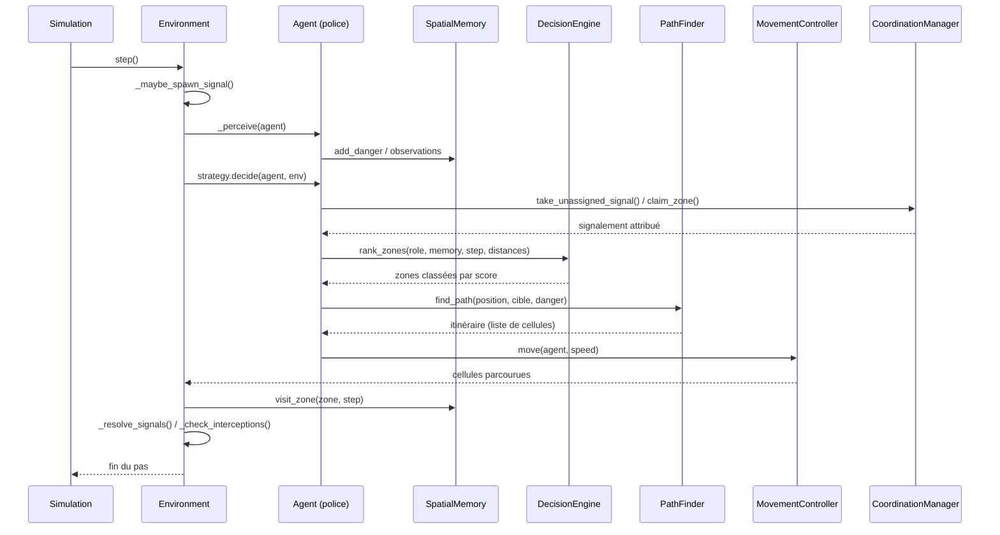
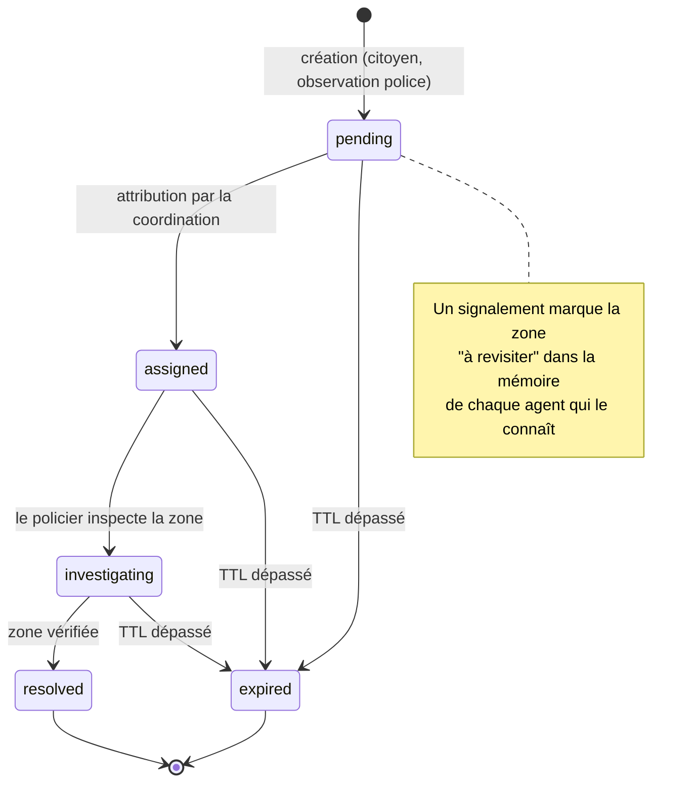
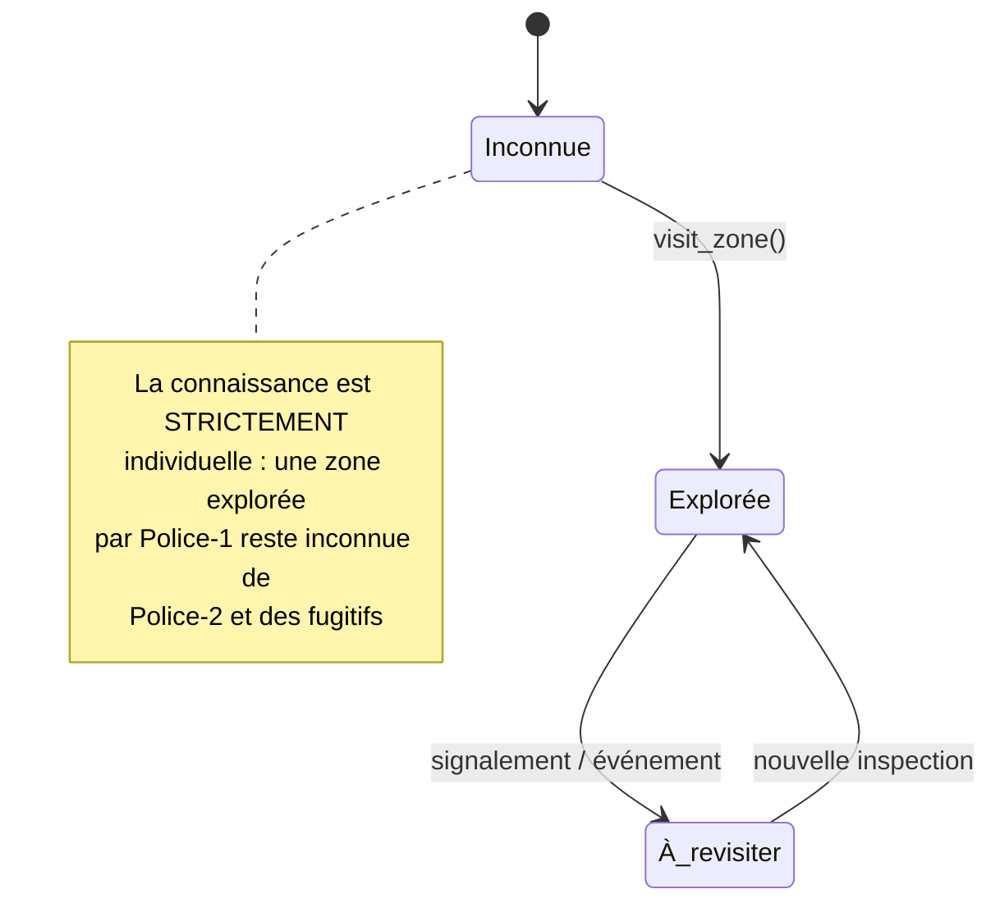
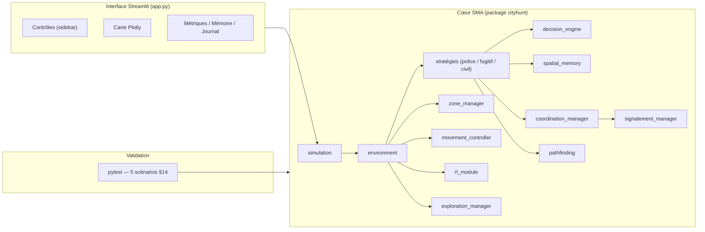
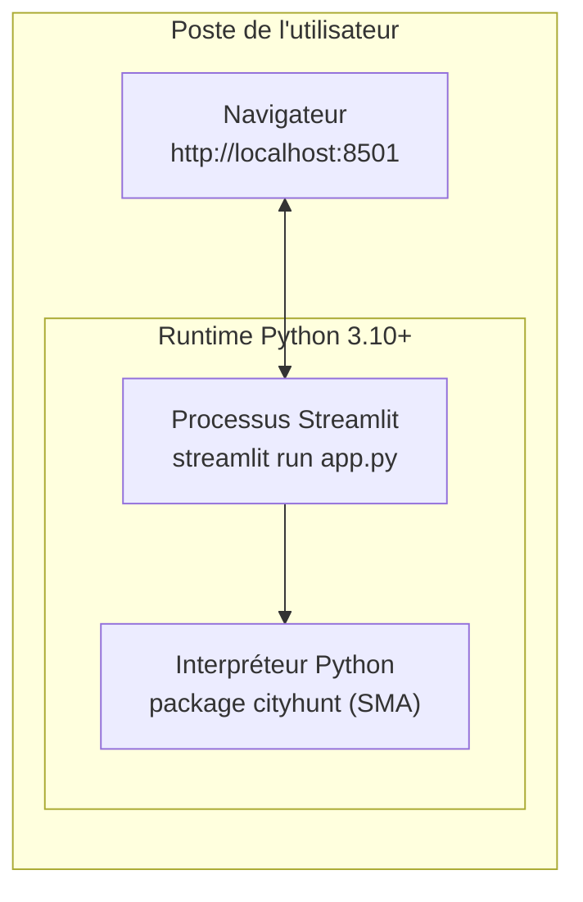

# CityHunt v2.0 — Documentation fonctionnelle et technique

**Type :** Système multi-agents (SMA) · **UI :** Streamlit · **Version :** 2.0

Ce document décrit l'implémentation de la spécification CityHunt v2.0 :
mémoire spatiale individuelle, exploration méthodique, signalements,
coordination policière, pathfinding A* et apprentissage par renforcement.

---

## 1. Architecture générale

Chaque responsabilité de la spécification (§10) correspond à un module Python :

| Module | Responsabilité | Spéc. |
|---|---|---|
| `zone_manager.py` | Découpage de la carte en zones, voisins, obstacles | §4 |
| `spatial_memory.py` | Mémoire spatiale individuelle (`SpatialMemory`) | §5 |
| `exploration_manager.py` | Couverture, historique, fin d'exploration | §7 |
| `decision_engine.py` | Scores de zones et sélection des destinations | §6 |
| `police_strategy.py` | Stratégie policière | §3.1 |
| `fugitive_strategy.py` | Stratégie de fuite | §3.2 |
| `civil_strategy.py` | Déplacement aléatoire | §3.3 |
| `coordination_manager.py` | Partage d'informations et réservations | §8 |
| `signalement_manager.py` | Cycle de vie des signalements | §7.3 |
| `pathfinding.py` | Itinéraires A* | §9 |
| `movement_controller.py` | Exécution des déplacements | §9 |
| `rl_module.py` | Récompenses et Q-values | §12 |
| `agents.py`, `environment.py`, `simulation.py` | Agents, perception, boucle | §10 |



---

## 2. Diagramme de classes UML



---

## 3. Diagramme d'objets (OD) — instantané de simulation

Exemple d'état au pas 42 : deux policiers, un fugitif, un civil.

```mermaid
objectDiagram
    object "Police-1 : Agent" as p1
    p1 : id = "Police-1"
    p1 : role = "police"
    p1 : position = (7, 3)
    p1 : speed = 2

    object "mem1 : SpatialMemory" as m1
    m1 : visited_zones = {0, 1, 5, 6}
    m1 : unvisited_zones = {2, 3, 4, 7, ...}
    m1 : current_zone = 6

    object "k6 : ZoneKnowledge" as k6
    k6 : state = "explorée"
    k6 : visit_count = 2
    k6 : danger_level = 0.0

    object "Fugitif-1 : Agent" as f1
    f1 : role = "fugitive"
    f1 : position = (18, 15)

    object "memF : SpatialMemory" as mf
    mf : known_dangers = {6: 0.4}
    mf : unvisited_zones = {8, 9, 13, ...}

    object "SIG-0007 : Signalement" as s7
    s7 : zone_id = 6
    s7 : status = "investigating"
    s7 : priority = 2

    object "Civil-1 : Agent" as c1
    c1 : role = "civil"
    c1 : position = (11, 9)

    p1 *-- m1
    m1 *-- k6
    f1 *-- mf
    s7 --> p1 : assigned_to
```

---

## 4. Cycle de décision (diagramme d'activité)



---

## 5. Diagramme de séquence — un pas de simulation



---

## 6. Diagrammes d'états

### 6.1 Cycle de vie d'un signalement



### 6.2 Connaissance d'une zone par un agent



---

## 7. Diagramme de composants



---

## 8. Diagramme de déploiement



Déploiement mono-processus, sans base de données ni service externe : l'état de
la simulation vit dans la session Streamlit (`st.session_state`). Pour un
déploiement multi-utilisateur, lancer `streamlit run app.py --server.port 8501`
derrière un reverse proxy interne.

---

## 9. Moteur de décision

### 9.1 Scores (§6 de la spécification)

**Police** — `Score(z) = w1·S(z) + w2·P(z) + w3·U(z) − w4·D(z)`

| Terme | Implémentation (`decision_engine.py`) |
|---|---|
| `S(z)` pertinence du signalement | priorité × confiance × fraîcheur des signalements connus |
| `P(z)` probabilité de présence | déduite des observations uniquement (signalements, ancienneté de la dernière visite) |
| `U(z)` intérêt d'exploration | 1.0 inconnue, 0.8 à revisiter, sinon décroît avec l'ancienneté |
| `D(z)` coût du déplacement | distance Manhattan inter-zones |

**Fugitif** — `Score(z) = w1·E(z) + w2·S(z) − w3·R(z) − w4·C(z)`

| Terme | Implémentation |
|---|---|
| `E(z)` intérêt d'exploration | identique à `U(z)` |
| `S(z)` sécurité estimée | `1 − danger connu de la zone` |
| `R(z)` risque de rencontre | danger mémorisé (zones où un policier a été vu) |
| `C(z)` coût du déplacement | distance Manhattan inter-zones |

Les poids sont ajustables dans la barre latérale Streamlit.

### 9.2 Priorités du cycle (§11)

1. **Police** : signalement attribué → poursuite d'un fugitif **visible** → zones inconnues → revisite / patrouille du secteur assigné.
2. **Fugitif** : fuite si policier dans `PANIC_RADIUS` → zones inconnues sûres → zones connues sûres.
3. **Civil** : cellule voisine aléatoire à chaque pas.

---

## 10. Coordination policière (§8)

`CoordinationManager` centralise :

- **secteurs** : `assign_sectors()` distribue les zones entre policiers ;
- **réservations** : `claim_zone()` empêche deux policiers d'inspecter la même zone simultanément ;
- **signalements** : `take_unassigned_signal()` attribue le signalement pending le plus prioritaire ;
- **observations** : `share_observation()` journalise les fugitifs vus.

Le partage **ne fusionne pas** les mémoires : chaque policier conserve sa propre
`SpatialMemory` (les zones vues par un autre restent « inconnues » localement).

---

## 11. Pathfinding A* (§9)

`PathFinder.find_path(start, goal, danger)` implémente A* 4-connexe :

- `f(n) = g(n) + h(n)` avec heuristique de Manhattan (admissible) ;
- coût d'entrée d'une cellule : `1.0 + 10 × danger_connu(cellule)` ;
- obstacles exclus du graphe ;
- recalcul automatique si l'itinéraire est obstrué ou terminé (F13).

---

## 12. Apprentissage par renforcement (§12, Phase 7)

`RLModule` maintient des Q-values par zone (`q[zone]`) mises à jour par
`q ← q + α·(r − q)` avec les récompenses de la spécification :

| Agent | Événement | Récompense |
|---|---|---:|
| Police | Nouvelle zone inspectée | +5 |
| Police | Signalement vérifié | +15 |
| Police | Fugitif intercepté | +100 |
| Police | Déplacement inutile | −5 |
| Fugitif | Nouvelle zone explorée | +5 |
| Fugitif | Évasion réussie | +100 |
| Fugitif | Détection par la police | −20 |

Le bonus `0.05 × q[zone]` est ajouté au score du moteur de décision. Aucune
récompense ne révèle la position d'un adversaire (F12) : elle provient
toujours d'un événement vécu par l'agent.

---

## 13. Traçabilité des exigences F01–F15

| ID | Exigence | Implémentation | Test |
|---|---|---|---|
| F01 | Police non aléatoire | `PoliceStrategy.decide` | `test_1`, `test_f01_f02` |
| F02 | Fugitifs non aléatoires | `FugitiveStrategy.decide` | `test_4`, `test_f01_f02` |
| F03 | Civils aléatoires | `CivilStrategy.decide` | `test_f03` |
| F04 | Mémoire individuelle | `SpatialMemory` par agent | tous |
| F05 | Persistance des zones visitées | mémoire jamais réinitialisée | `test_f05_f14` |
| F06 | Zones inconnues prioritaires | `_exploration_candidates` + score `U` | `test_1` |
| F07 | Revisite sur événement | `mark_to_revisit` + signalements | `test_2` |
| F08 | Partage d'informations | `CoordinationManager` | `test_3` |
| F09 | Éviter les doublons | `claim_zone`, secteurs | `test_3` |
| F10 | Adaptation aux dangers | `known_dangers`, `_flee` | `test_4` |
| F11 | Obstacles dans les itinéraires | A* avec obstacles | `test_f11` |
| F12 | Pas d'omniscience | perception à rayon limité | `test_5` |
| F13 | Recalcul des destinations | `route_is_blocked` + redécision | `test_f11` |
| F14 | Historique conservé | `exploration_history` | `test_f05_f14` |
| F15 | Amélioration par apprentissage | `RLModule` | `test_interception_possible` |

---

## 14. Utilisation de l'interface Streamlit

1. Configurer le monde et les agents dans la **barre latérale** (taille, zones, obstacles, effectifs, vitesses, poids, RL).
2. **🔄 Nouvelle simulation** réinitialise le monde avec ces paramètres.
3. Avancer avec **▶ 1 pas**, **▶▶ 10 pas**, **▶▶▶ 50 pas** ou la **lecture auto**.
4. Onglet **Carte** : positions des agents ; sélectionner un agent pour colorer les zones selon **sa** mémoire (⬜ inconnue, 🟦 explorée, 🟧 à revisiter).
5. Onglet **Métriques** : couverture globale, signalements, résumé JSON.
6. Onglet **Mémoire** : historique d'exploration et événements RL d'un agent.
7. Onglet **Journal** : découvertes, observations partagées, interceptions.
